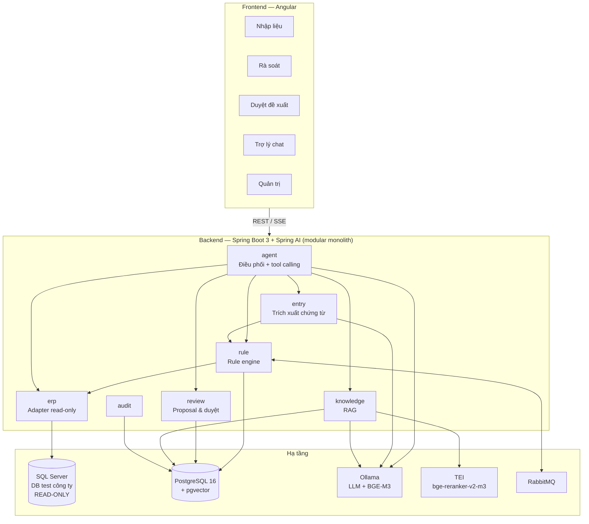

# ERP AI Assistant

> **AI Agent + RAG hỗ trợ nhập liệu và rà soát dữ liệu trong hệ thống ERP kế toán**
> Đồ án môn **Dự án công nghệ** — Trường Đại học Công nghệ, ĐHQG Hà Nội

---

## 1. Giới thiệu

Trong các hệ thống ERP kế toán, sai sót khi nhập liệu (sai thuế suất, lệch tổng tiền, nhập trùng hóa đơn, định khoản sai tài khoản…) thường chỉ được phát hiện khi đối chiếu cuối kỳ, gây tốn thời gian và rủi ro về thuế. **ERP AI Assistant** giải quyết bài toán này bằng cách kết hợp ba thành phần:

| Thành phần | Vai trò |
|---|---|
| **Rule Engine** | Phát hiện sai lệch một cách **tất định**, có thể kiểm chứng (Nợ ≠ Có, tiền thuế sai, hóa đơn trùng…) |
| **RAG** (Retrieval-Augmented Generation) | Truy xuất văn bản pháp luật, chế độ kế toán, tài liệu hướng dẫn để **giải thích** lỗi kèm trích dẫn nguồn |
| **AI Agent** | **Điều phối** các chức năng: trích xuất chứng từ, chạy rule, tra cứu tri thức, sinh đề xuất sửa |

### Nguyên tắc thiết kế cốt lõi

1. **Rule quyết định đúng/sai — LLM chỉ giải thích và đề xuất.**
2. **CSDL ERP chỉ đọc (read-only).** Mọi thay đổi chỉ là *đề xuất*, phải được con người duyệt.
3. **Mọi câu trả lời có trích dẫn nguồn**; không đủ căn cứ thì nói rõ.
4. **Dữ liệu nhạy cảm không rời hệ thống**: LLM mặc định chạy local (Ollama); khi dùng LLM cloud thì bắt buộc che (mask) dữ liệu.
5. **Mọi hành động đều được ghi nhật ký (audit log).**

---

## 2. Chức năng chính

### 2.1. Hỗ trợ nhập liệu
- Nhập từ **hóa đơn điện tử XML**, **ảnh/PDF** (OCR bằng LLM vision) hoặc **mô tả bằng lời**.
- Tự điền form chứng từ, gợi ý **định khoản Nợ/Có**, hiển thị độ tin cậy từng trường.
- Kiểm tra rule ngay khi nhập, trước khi lưu.

### 2.2. Rà soát & phát hiện sai lệch
- Rà soát **tức thời** từng chứng từ và rà soát **hàng loạt** theo kỳ (chạy nền qua RabbitMQ).
- 5 nhóm rule: trường dữ liệu (`FLD`), nội chứng từ (`DOC`), liên chứng từ (`XDOC`), quy định (`REG`), bất thường (`ANM`).
- Phân loại mức độ: `ERROR` / `WARNING` / `INFO`.

### 2.3. Giải thích & đề xuất xử lý
- Giải thích lỗi bằng ngôn ngữ tự nhiên, **trích dẫn Điều/Khoản** văn bản.
- Đề xuất giá trị đúng hoặc bút toán điều chỉnh; đề xuất được **kiểm chứng lại bằng rule** trước khi hiển thị.

### 2.4. Duyệt đề xuất
- So sánh **trước/sau**, Chấp nhận / Từ chối kèm lý do, phân quyền theo vai trò.
- Đề xuất đã duyệt được xuất thành **phiếu đề nghị điều chỉnh** (không tự ghi vào ERP).

### 2.5. Trợ lý hỏi đáp nghiệp vụ
- Hỏi đáp về quy định, cách dùng phần mềm, và dữ liệu ("Tháng 10 có bao nhiêu hóa đơn chưa thanh toán?").
- Trả lời dạng stream, kèm trích dẫn.

### 2.6. Quản trị
- Quản lý rule (bật/tắt, chỉnh ngưỡng), kho tri thức (tải văn bản, hiệu lực), dashboard thống kê, xem audit log.

---

## 3. Kiến trúc tổng quan



Chi tiết: xem [`docs/architecture.md`](docs/architecture.md). API: xem [`docs/api-spec.md`](docs/api-spec.md).

---

## 4. Công nghệ sử dụng

| Lớp | Công nghệ |
|---|---|
| Backend | Java 21, Spring Boot 3.x, Spring AI 1.x, Spring Security (JWT), Spring Data JPA, JdbcTemplate |
| Rule engine | Rule YAML + SpEL / SQL |
| AI | Ollama (LLM Qwen, embedding **BGE-M3**), HuggingFace TEI (**bge-reranker-v2-m3**) |
| CSDL | SQL Server (ERP, chỉ đọc), PostgreSQL 16 + pgvector (ứng dụng), Liquibase |
| Messaging | RabbitMQ |
| Frontend | Angular (standalone components), Angular Material |
| Test | JUnit 5, Mockito, AssertJ, Testcontainers, ArchUnit |
| Vận hành | Docker Compose, Spring Boot Actuator, Langfuse (tùy chọn) |

---

## 5. Cấu trúc repository

```
erp-ai-assistant/
├── README.md               # File này
├── CLAUDE.md               # Quy chuẩn cho AI agent / developer
├── .env.example            # Mẫu biến môi trường
├── docker-compose.yml      # Hạ tầng local
├── docs/                   # architecture.md, api-spec.md, adr/, báo cáo
├── knowledge/              # Tài liệu nguồn cho RAG (+ *.meta.yml)
├── eval/                   # Bộ dữ liệu & kết quả đánh giá
├── backend/                # Spring Boot (Maven)
└── frontend/               # Angular
```

Chi tiết cấu trúc thư mục: xem [`CLAUDE.md`](CLAUDE.md#3-cấu-trúc-thư-mục).

---

## 6. Hướng dẫn cài đặt (Setup Guide)

### 6.1. Yêu cầu hệ thống

| Thành phần | Phiên bản / Yêu cầu |
|---|---|
| OS | Ubuntu 22.04+ (khuyến nghị), macOS, Windows + WSL2 |
| JDK | **21** (Temurin hoặc tương đương) |
| Maven | Dùng Maven Wrapper `./mvnw` có sẵn trong repo |
| Node.js | **20 LTS** trở lên, npm 10+ |
| Docker | Docker Engine 24+ và Docker Compose v2 |
| RAM | Tối thiểu **16 GB** (Ollama với model 7B chiếm ~6–8 GB) |
| GPU | Không bắt buộc; có GPU NVIDIA thì LLM nhanh hơn đáng kể |
| Mạng | Truy cập được tới **SQL Server DB test của công ty** (VPN nếu cần) |

### 6.2. Clone & cấu hình biến môi trường

```bash
git clone <repo-url> erp-ai-assistant
cd erp-ai-assistant
cp .env.example .env
```

Mở `.env` và điền các giá trị:

```dotenv
# ===== ERP (SQL Server – DB test công ty, CHỈ ĐỌC) =====
ERP_DB_URL=jdbc:sqlserver://<host>:1433;databaseName=<db>;encrypt=true;trustServerCertificate=true
ERP_DB_USER=<tai_khoan_read_only>
ERP_DB_PASSWORD=<mat_khau>
ERP_DEFAULT_COMPANY_ID=<company-id-dung-de-demo>

# ===== DB ứng dụng (PostgreSQL + pgvector) =====
APP_DB_HOST=localhost
APP_DB_PORT=5432
APP_DB_NAME=erpai
APP_DB_USER=erpai
APP_DB_PASSWORD=erpai_dev

# ===== AI =====
AI_PROVIDER=ollama                      # ollama | openai | anthropic
OLLAMA_BASE_URL=http://localhost:11434
AI_CHAT_MODEL=qwen2.5:7b
AI_EMBEDDING_MODEL=bge-m3
AI_EMBEDDING_DIMENSIONS=1024
RERANKER_BASE_URL=http://localhost:8081
# Chỉ cần khi AI_PROVIDER khác ollama (dữ liệu sẽ được mask trước khi gửi)
AI_API_KEY=

# ===== RabbitMQ =====
RABBITMQ_HOST=localhost
RABBITMQ_PORT=5672
RABBITMQ_USER=erpai
RABBITMQ_PASSWORD=erpai_dev

# ===== Bảo mật =====
JWT_SECRET=<chuoi-ngau-nhien-toi-thieu-64-ky-tu>
JWT_ACCESS_TTL_MINUTES=60
```

> ⚠️ **Tuyệt đối không commit file `.env`** và không dùng tài khoản SQL Server có quyền ghi.
> Nên đề nghị DBA cấp một user chỉ có quyền `db_datareader` trên DB test.

### 6.3. Khởi động hạ tầng

```bash
docker compose up -d
docker compose ps        # Đảm bảo tất cả service ở trạng thái healthy
```

| Service | Image | Cổng | Mục đích |
|---|---|---|---|
| `postgres` | `pgvector/pgvector:pg16` | 5432 | DB ứng dụng + vector store |
| `ollama` | `ollama/ollama` | 11434 | LLM chat + embedding |
| `reranker` | `ghcr.io/huggingface/text-embeddings-inference` (CPU) | 8081 | Rerank kết quả truy xuất |
| `rabbitmq` | `rabbitmq:3-management` | 5672 / 15672 | Hàng đợi rà soát hàng loạt |
| `langfuse` *(profile `observability`)* | `langfuse/langfuse` | 3000 | Trace LLM (tùy chọn) |

Tải model cho Ollama (lần đầu, ~5 GB):

```bash
docker compose exec ollama ollama pull qwen2.5:7b
docker compose exec ollama ollama pull bge-m3
docker compose exec ollama ollama list
```

### 6.4. Chạy backend

```bash
cd backend
./mvnw clean verify                                    # Build + test
./mvnw spring-boot:run -Dspring-boot.run.profiles=dev  # Chạy ở http://localhost:8080
```

Khi khởi động, ứng dụng sẽ:
1. Chạy Liquibase migration **chỉ trên PostgreSQL**.
2. Kiểm tra kết nối SQL Server (chỉ `SELECT 1`) — lỗi kết nối sẽ được log rõ ràng.
3. Nạp rule từ `src/main/resources/rules/**/*.yml` vào bảng `rule_definition`.
4. Tạo tài khoản mặc định cho môi trường `dev` (xem mục 6.7).

Kiểm tra sức khỏe:

```bash
curl http://localhost:8080/actuator/health
# {"status":"UP","components":{"appDb":{"status":"UP"},"erpDb":{"status":"UP"},"ollama":{"status":"UP"}, ...}}
```

### 6.5. Nạp kho tri thức (RAG)

Đặt tài liệu vào `knowledge/` theo quy ước trong `CLAUDE.md`, mỗi file kèm một `*.meta.yml`:

```yaml
# knowledge/circular/tt-xx-yyyy-btc_che-do-ke-toan.meta.yml
title: "Thông tư hướng dẫn chế độ kế toán doanh nghiệp"
docNumber: "XX/YYYY/TT-BTC"
docType: CIRCULAR
issuedDate: 2025-01-01
effectiveFrom: 2025-01-01
effectiveTo: null
supersededBy: null
sourceUrl: "https://..."
```

Chạy ingestion:

```bash
cd backend
./mvnw spring-boot:run -Dspring-boot.run.profiles=dev,ingest
```

Hoặc tải lên qua giao diện **Quản trị → Kho tri thức** / API `POST /api/v1/knowledge/documents`.

### 6.6. Chạy frontend

```bash
cd frontend
npm ci
npm start            # http://localhost:4200, proxy /api → http://localhost:8080
```

### 6.7. Tài khoản mặc định (chỉ profile `dev`)

| Username | Mật khẩu | Vai trò |
|---|---|---|
| `accountant` | `accountant@123` | `ACCOUNTANT` — kế toán viên |
| `chief` | `chief@123` | `CHIEF_ACCOUNTANT` — kế toán trưởng, duyệt đề xuất |
| `admin` | `admin@123` | `ADMIN` — quản trị rule, kho tri thức |

### 6.8. Chạy toàn bộ bằng Docker

```bash
docker compose --profile app up -d --build
# Frontend: http://localhost:4200   Backend: http://localhost:8080
```

---

## 7. Kiểm thử & đánh giá

```bash
cd backend
./mvnw test                                           # Unit test
./mvnw verify                                         # Unit + integration test (cần Docker)
./mvnw spring-boot:run -Dspring-boot.run.profiles=dev,eval   # Đánh giá rule & RAG → eval/reports/
```

Các chỉ số đánh giá chính:

| Thành phần | Chỉ số |
|---|---|
| Rule engine | Precision / Recall trên bộ chứng từ cài lỗi có nhãn |
| RAG | Hit@k, MRR, tỷ lệ trích dẫn đúng, faithfulness |
| Agent | Tỷ lệ đề xuất vượt qua kiểm chứng rule, tỷ lệ được chấp nhận |
| Hiệu năng | Latency P50/P95 cho giải thích lỗi, thời gian rà soát 1.000 chứng từ |

---

## 8. Xử lý sự cố thường gặp

| Hiện tượng | Nguyên nhân & cách xử lý |
|---|---|
| `SQLServerException: The driver could not establish a secure connection` | Thêm `encrypt=true;trustServerCertificate=true` vào `ERP_DB_URL`, kiểm tra VPN |
| `Login failed for user` | Sai tài khoản hoặc user chưa có quyền `db_datareader` trên DB |
| Ollama trả lời rất chậm / bị kill | Thiếu RAM — dùng model nhỏ hơn (`qwen2.5:3b`) hoặc tăng RAM cho Docker |
| `expected 1024 dimensions` khi ingest | `AI_EMBEDDING_DIMENSIONS` không khớp model embedding; đổi model thì phải tạo lại bảng vector & re-index |
| Cổng 5432 / 4200 bị chiếm | Đổi cổng trong `.env` / `docker-compose.yml`, hoặc dừng tiến trình đang chiếm |
| IntelliJ chậm, hết RAM | Tắt bớt plugin (SonarLint), tăng `-Xmx` cho IDE, hạn chế chạy Ollama song song khi build |

---

## 9. Tài liệu liên quan

| Tài liệu | Nội dung |
|---|---|
| [`CLAUDE.md`](CLAUDE.md) | Quy chuẩn code, cấu trúc thư mục, naming, lệnh build/test |
| [`docs/architecture.md`](docs/architecture.md) | Kiến trúc chi tiết, luồng dữ liệu, thiết kế CSDL, thiết kế Agent & RAG |
| [`docs/api-spec.md`](docs/api-spec.md) | Đặc tả RESTful API |
| `docs/adr/` | Các quyết định kiến trúc (Architecture Decision Records) |

---

## 10. Nhóm thực hiện

| Thành viên | MSSV | Phụ trách |
|---|---|---|
| Trần Thành Nguyên | | |
| | | |

Giảng viên hướng dẫn: ……………………
