# Kiến trúc hệ thống — ERP AI Assistant

| Thuộc tính | Giá trị |
|---|---|
| Phiên bản tài liệu | 1.1 (đã đối chiếu với mã nguồn) |
| Trạng thái | Draft |
| Phạm vi | Toàn bộ hệ thống: backend, frontend, hạ tầng AI, CSDL |
| Tài liệu liên quan | [`README.md`](../README.md), [`CLAUDE.md`](../CLAUDE.md), [`api-spec.md`](api-spec.md) |

---

## Mục lục

1. [Mục tiêu & ràng buộc kiến trúc](#1-mục-tiêu--ràng-buộc-kiến-trúc)
2. [Sơ đồ ngữ cảnh (System Context)](#2-sơ-đồ-ngữ-cảnh-system-context)
3. [Sơ đồ container](#3-sơ-đồ-container)
4. [Phân rã module (Component)](#4-phân-rã-module-component)
5. [Luồng dữ liệu (Data Flow)](#5-luồng-dữ-liệu-data-flow)
6. [Thiết kế Rule Engine](#6-thiết-kế-rule-engine)
7. [Thiết kế RAG](#7-thiết-kế-rag)
8. [Thiết kế AI Agent](#8-thiết-kế-ai-agent)
9. [Thiết kế cơ sở dữ liệu](#9-thiết-kế-cơ-sở-dữ-liệu)
10. [Bảo mật](#10-bảo-mật)
11. [Yêu cầu phi chức năng & triển khai](#11-yêu-cầu-phi-chức-năng--triển-khai)
12. [Quyết định kiến trúc (ADR)](#12-quyết-định-kiến-trúc-adr)
13. [Đối chiếu thiết kế ↔ triển khai](#13-đối-chiếu-thiết-kế--triển-khai)

---

## 1. Mục tiêu & ràng buộc kiến trúc

### 1.1. Mục tiêu
- Phát hiện sai lệch dữ liệu kế toán **chính xác, giải thích được, kiểm chứng được**.
- Giảm thời gian nhập liệu chứng từ nhờ trích xuất tự động và gợi ý định khoản.
- Cung cấp giải thích có **căn cứ pháp lý/tài liệu** cho từng sai lệch.

### 1.2. Ràng buộc
| # | Ràng buộc | Hệ quả kiến trúc |
|---|---|---|
| C1 | Dữ liệu nguồn là **DB test SQL Server của công ty**, gần như dữ liệu thật | Truy cập READ-ONLY; không đưa DB ERP vào Docker; LLM local mặc định; masking khi dùng cloud |
| C2 | Nhóm thành thạo **Spring Boot / Angular** | Toàn bộ backend Java (Spring AI), không tách service Python |
| C3 | Thời gian 1 học kỳ, hạ tầng hạn chế | **Modular monolith**, Docker Compose, model 7B chạy CPU được |
| C4 | Lĩnh vực tài chính – kế toán | Rule tất định, human-in-the-loop, audit log đầy đủ |

### 1.3. Thuộc tính chất lượng ưu tiên
1. **Tính đúng đắn & kiểm chứng được** (correctness, traceability)
2. **Bảo mật dữ liệu** (confidentiality)
3. **Khả năng mở rộng rule & tri thức** (extensibility) — thêm rule/văn bản không cần sửa code
4. **Khả năng quan sát** (observability) — truy vết được Agent đã làm gì
5. Hiệu năng ở mức chấp nhận được (giải thích lỗi P95 < 15s trên CPU)

---

## 2. Sơ đồ ngữ cảnh (System Context)

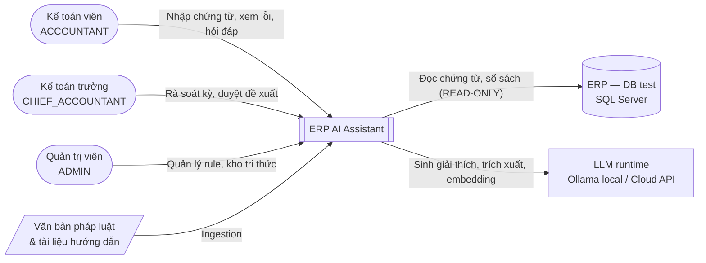

---

## 3. Sơ đồ container

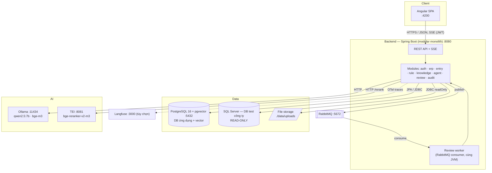

**Lý do chọn modular monolith:** một đơn vị triển khai, dễ debug và demo; ranh giới module được giữ bằng package + ArchUnit nên có thể tách thành microservice sau này (ví dụ tách `knowledge` hoặc review worker) mà không viết lại.

---

## 4. Phân rã module (Component)

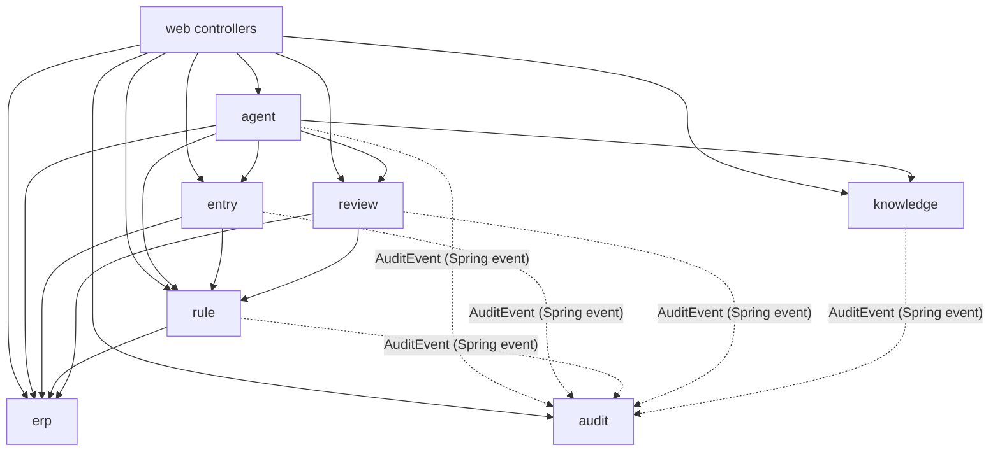

| Module | Trách nhiệm | API công khai (service) | Lưu trữ |
|---|---|---|---|
| **auth** | Đăng nhập, JWT, người dùng, vai trò | `AuthService`, `CurrentUser` | `app_user` |
| **erp** (M1) | Đọc dữ liệu ERP, chuẩn hóa sang canonical model | `ErpQueryService` | — (SQL Server, chỉ đọc) |
| **entry** (M2) | Trích xuất chứng từ (XML/ảnh/text), gợi ý định khoản, tạo nháp | `EntryDraftService` | `entry_draft`, `uploaded_file` |
| **rule** (M3) | Nạp & đánh giá rule, tạo violation, job rà soát hàng loạt | `RuleEngine`, `ViolationService`, `ReviewJobService` | `rule_definition`, `violation`, `review_job` |
| **knowledge** (M4) | Ingestion tài liệu, chunking, embedding, hybrid search, rerank | `KnowledgeService`, `HybridRetriever` | `knowledge_document`, `knowledge_chunk` |
| **agent** (M5) | Điều phối workflow, tool calling, phiên hội thoại | `ExplainViolationWorkflow`, `EntryAssistWorkflow`, `ChatWorkflow` | `agent_session`, `agent_message`, `violation_explanation` |
| **review** (M6) | Tạo, kiểm chứng, duyệt, xuất đề xuất | `ProposalService` | `proposal` |
| **audit** (M7) | Audit log, feedback, thống kê dashboard | `AuditService`, `FeedbackService` | `audit_log`, `feedback` |

---

## 5. Luồng dữ liệu (Data Flow)

### 5.1. F1 — Nhập liệu từ hóa đơn điện tử XML

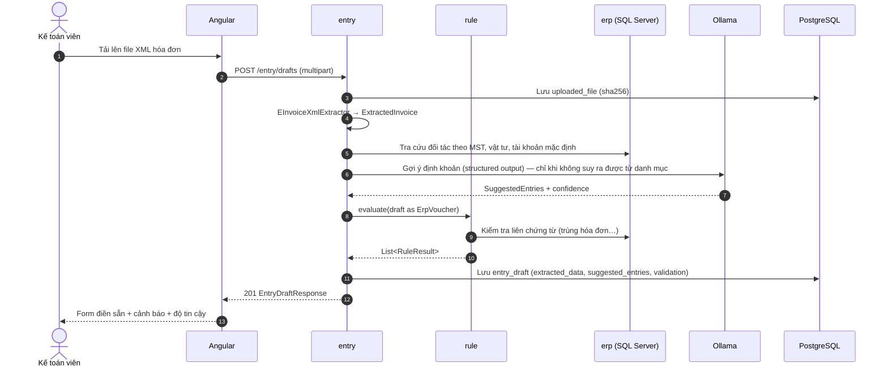

> Với ảnh/PDF, bước 4 thay bằng `VisionExtractor` (LLM đa phương thức). Trường có `confidence < app.entry.min-confidence` được đánh dấu cần kiểm tra.

### 5.2. F2 — Rà soát tức thời một chứng từ

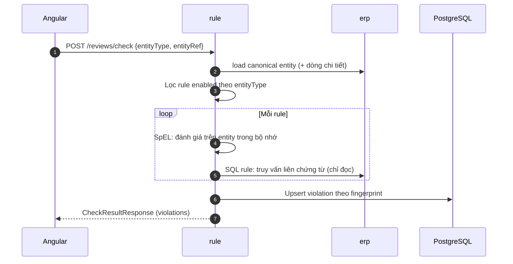

### 5.3. F3 — Rà soát hàng loạt theo kỳ

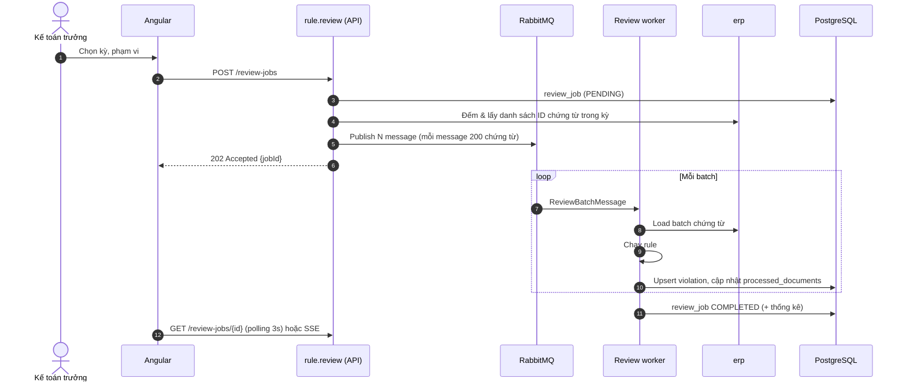

- Message lỗi được retry 3 lần (backoff), sau đó vào **DLQ** `review.batch.dlq`; job ghi nhận `failed_batches`.
- Job có thể hủy (`CANCELLED`): worker kiểm tra trạng thái trước mỗi batch.

### 5.4. F4 — Giải thích lỗi & sinh đề xuất

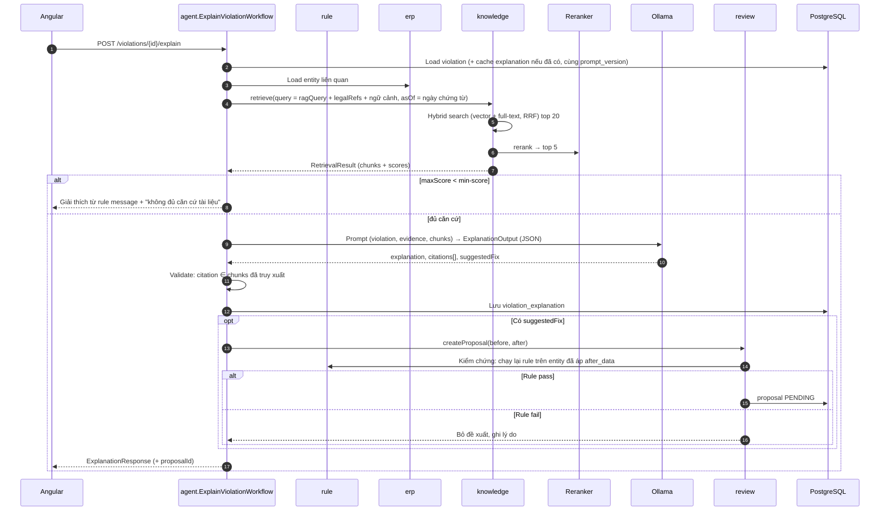

### 5.5. F5 — Duyệt đề xuất

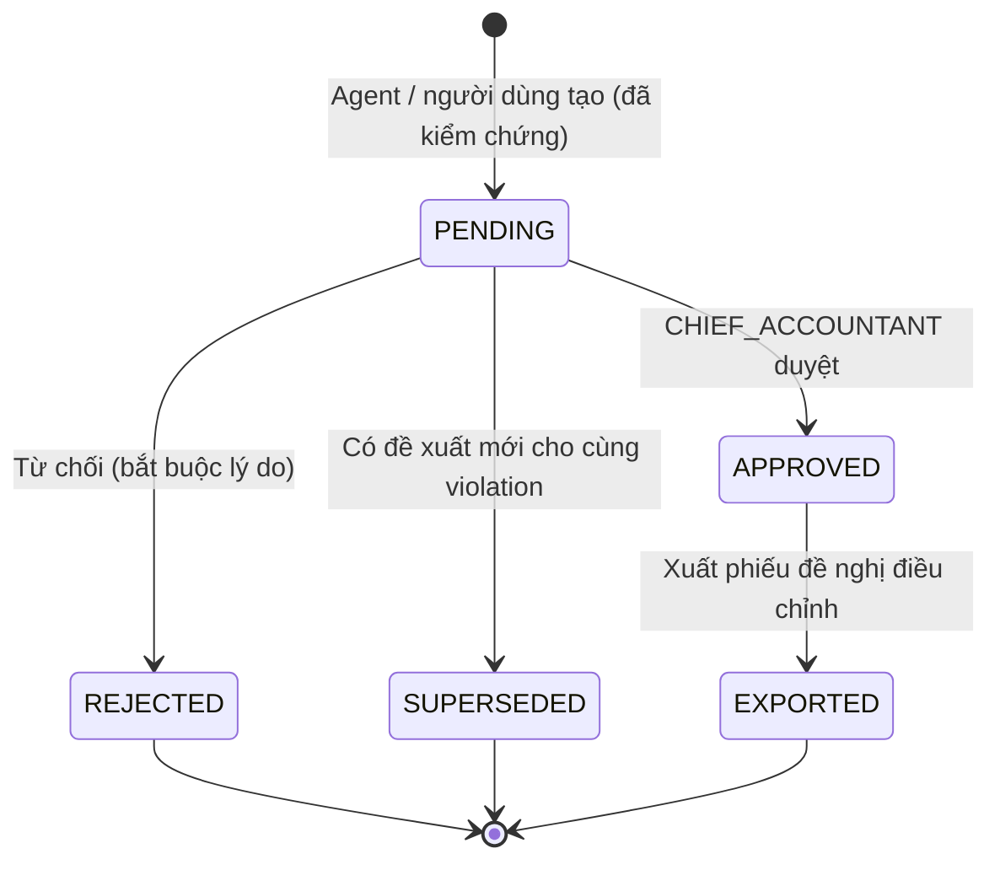

- Khi `APPROVED`, violation liên quan chuyển `RESOLVED_PENDING_ERP`; sau khi dữ liệu ERP được sửa thủ công, lần rà soát kế tiếp không còn phát hiện → `RESOLVED`.
- Hệ thống **không ghi ngược ERP**. Cổng `ErpWriteBackPort` được định nghĩa sẵn (interface) với cài đặt mặc định `ExportOnlyWriteBack` để mở rộng trong tương lai.

### 5.6. F6 — Trợ lý hỏi đáp (chat, streaming)

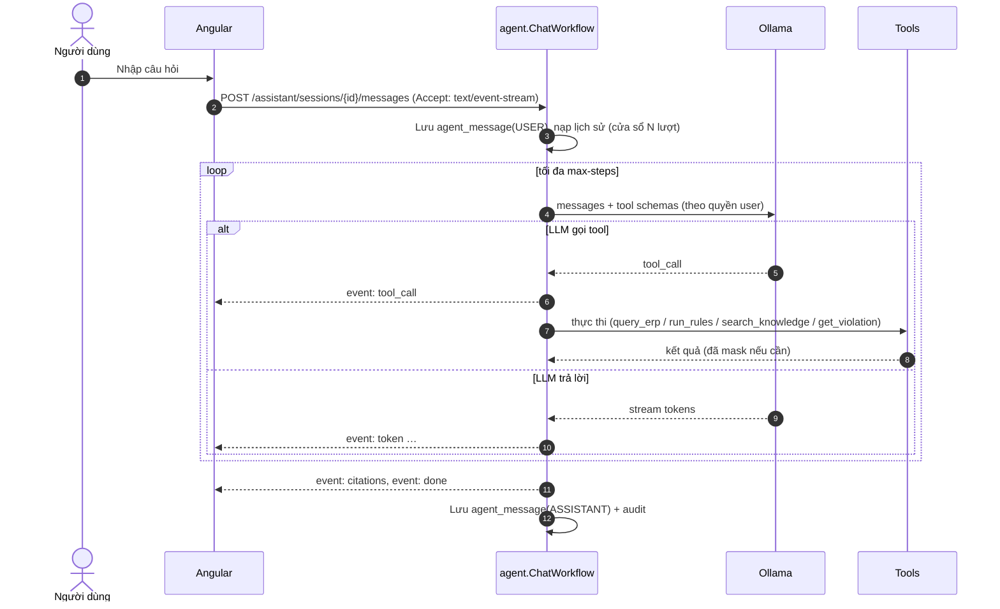

### 5.7. F7 — Ingestion tài liệu tri thức

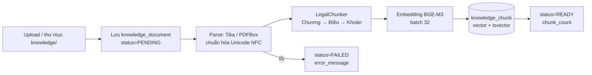

---

## 6. Thiết kế Rule Engine

### 6.1. Mô hình rule (YAML)

```yaml
# rules/doc/doc-vat-amount-mismatch.yml
ruleId: DOC_VAT_AMOUNT_MISMATCH
name: "Tiền thuế GTGT không khớp thuế suất"
group: DOC
severity: ERROR
entityType: PURCHASE_INVOICE          # PURCHASE_INVOICE | SALES_INVOICE | VOUCHER | JOURNAL_ENTRY | PAYMENT
evaluator: SPEL                       # SPEL | SQL
forEach: lines                        # (tùy chọn) đánh giá trên từng dòng chi tiết
params:
  tolerance: 1                        # cho phép lệch do làm tròn (đồng)
condition: >
  #abs(#item.vatAmount - #round(#item.amount * #item.vatRate)) > #params.tolerance
message: >
  Dòng {{item.lineNo}}: tiền thuế {{item.vatAmount}} không khớp
  {{item.vatRate*100}}% × {{item.amount}} = {{expected}}
evidence:
  expected: "#round(#item.amount * #item.vatRate)"
  actual: "#item.vatAmount"
legalRefs: ["Luật Thuế GTGT", "Nghị định về hóa đơn, chứng từ"]
ragQuery: "cách xác định số thuế GTGT ghi trên hóa đơn"
enabled: true
version: 1
```

```yaml
# rules/xdoc/xdoc-duplicate-invoice.yml
ruleId: XDOC_DUPLICATE_INVOICE
name: "Hóa đơn đầu vào bị nhập trùng"
group: XDOC
severity: ERROR
entityType: PURCHASE_INVOICE
evaluator: SQL
sqlRef: sql/erp/rule-duplicate-invoice.sql   # trả về các bản ghi trùng; có kết quả = vi phạm
sqlParams: [companyId, sellerTaxCode, invoiceSeries, invoiceNo, entityRef]
message: "Hóa đơn {{invoiceSeries}}-{{invoiceNo}} của MST {{sellerTaxCode}} đã được ghi nhận ở chứng từ {{dup.voucherNo}}"
legalRefs: []
ragQuery: "xử lý hóa đơn đầu vào bị kê khai trùng"
enabled: true
version: 1
```

```yaml
# rules/reg/reg-cash-payment-threshold.yml
ruleId: REG_CASH_PAYMENT_THRESHOLD
name: "Hóa đơn đạt ngưỡng phải thanh toán không dùng tiền mặt"
group: REG
severity: WARNING
entityType: PURCHASE_INVOICE
evaluator: SPEL
params:
  threshold: 0          # ĐIỀN theo quy định hiện hành; cấu hình qua Admin
condition: "#entity.totalAmount >= #params.threshold and #entity.paymentMethod == 'CASH'"
message: "Hóa đơn {{totalAmount}} thanh toán tiền mặt — có thể không đủ điều kiện khấu trừ thuế GTGT đầu vào"
ragQuery: "điều kiện khấu trừ thuế GTGT đầu vào chứng từ thanh toán không dùng tiền mặt"
enabled: true
version: 1
```

> Giá trị ngưỡng trong rule nhóm `REG` **luôn là tham số**, không hard-code, vì quy định thay đổi theo thời gian.

### 6.2. Danh mục rule MVP

| Nhóm | ruleId | Mô tả |
|---|---|---|
| FLD | `FLD_REQUIRED_FIELDS` | Thiếu trường bắt buộc (ngày, số chứng từ, đối tượng…) |
| FLD | `FLD_TAX_CODE_FORMAT` | MST sai định dạng (10 hoặc 10-3 chữ số) |
| FLD | `FLD_DATE_OUT_OF_PERIOD` | Ngày chứng từ ngoài kỳ kế toán đang mở |
| DOC | `DOC_DEBIT_CREDIT_UNBALANCED` | Tổng Nợ ≠ tổng Có |
| DOC | `DOC_VAT_AMOUNT_MISMATCH` | Tiền thuế ≠ tiền hàng × thuế suất |
| DOC | `DOC_TOTAL_MISMATCH` | Tiền hàng + thuế − chiết khấu ≠ tổng thanh toán |
| DOC | `DOC_INVALID_VAT_RATE` | Thuế suất không thuộc danh mục hợp lệ |
| DOC | `DOC_ACCOUNT_NOT_DETAIL` | Hạch toán vào tài khoản tổng hợp (không phải tài khoản chi tiết) |
| XDOC | `XDOC_DUPLICATE_INVOICE` | Trùng (MST bán, ký hiệu, số hóa đơn) |
| XDOC | `XDOC_PAYMENT_EXCEEDS_DEBT` | Thanh toán vượt công nợ còn lại |
| XDOC | `XDOC_NEGATIVE_STOCK` | Xuất kho vượt tồn |
| REG | `REG_CASH_PAYMENT_THRESHOLD` | Thanh toán tiền mặt hóa đơn đạt ngưỡng |
| REG | `REG_ACCOUNT_REGIME_MISMATCH` | Tài khoản không thuộc hệ thống tài khoản của chế độ kế toán công ty áp dụng |
| ANM | `ANM_UNIT_PRICE_OUTLIER` | Đơn giá lệch > k·σ so với lịch sử cùng vật tư – nhà cung cấp |

### 6.3. Luồng đánh giá

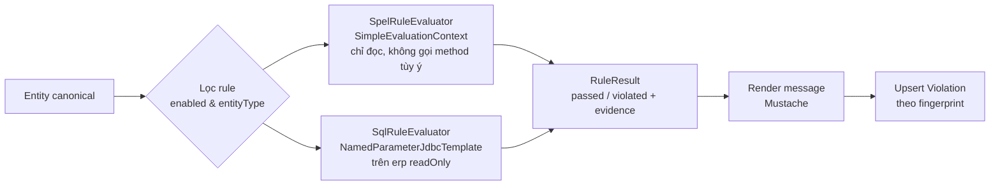

- SpEL chạy với `SimpleEvaluationContext` (chặn gọi constructor/static method tùy ý) và chỉ đăng ký một số hàm an toàn: `#abs`, `#round`, `#sum`, `#isBlank`, `#matches`.
- Timeout mỗi rule SQL: `app.rule.sql-timeout-seconds` (mặc định 5s).

---

## 7. Thiết kế RAG

### 7.1. Pipeline

| Bước | Thiết kế |
|---|---|
| Parse | Apache Tika (DOCX/HTML), PDFBox (PDF có text layer); chuẩn hóa Unicode NFC, bỏ header/footer lặp |
| Chunk | `LegalChunker`: nhận diện `Chương`, `Mục`, `Điều \d+`, `\d+\.` (khoản), `[a-zđ]\)` (điểm). Mỗi chunk = 1 Khoản (hoặc 1 Điều nếu ngắn). Giới hạn 512 token, overlap 0 với văn bản luật; 64 token với tài liệu hướng dẫn |
| Ngữ cảnh chunk | Tiền tố `headingPath` vào nội dung trước khi embed: `"[TT xx/yyyy] Chương II > Điều 5 > Khoản 2: ..."` |
| Embedding | BGE-M3 (1024 chiều, cosine), batch 32 |
| Lưu trữ | `knowledge_chunk.embedding vector(1024)` + `content_tsv tsvector` (config `simple` + `unaccent`) |
| Truy xuất | Hybrid: vector top 20 + full-text top 20 → hợp nhất **Reciprocal Rank Fusion** (k = 60) |
| Lọc | Chỉ văn bản `status = READY` và còn hiệu lực tại `asOf` (ngày chứng từ hoặc ngày hiện tại) |
| Rerank | bge-reranker-v2-m3 qua TEI → giữ top 5, loại chunk score < `app.rag.min-score` (mặc định 0.3) |
| Sinh | Prompt yêu cầu trích dẫn theo `chunkId`; backend map `chunkId` → (văn bản, Điều, Khoản) |

### 7.2. Truy vấn hybrid (RRF)

```sql
WITH params AS (
    SELECT CAST(:queryEmbedding AS vector(1024)) AS qv,
           plainto_tsquery('simple', unaccent(:queryText))  AS qt
),
valid_docs AS (
    SELECT id FROM knowledge_document
    WHERE status = 'READY'
      AND (effective_from IS NULL OR effective_from <= :asOf)
      AND (effective_to   IS NULL OR effective_to   >  :asOf)
),
vec AS (
    SELECT c.id, ROW_NUMBER() OVER (ORDER BY c.embedding <=> p.qv) AS rnk
    FROM knowledge_chunk c, params p
    WHERE c.document_id IN (SELECT id FROM valid_docs)
    ORDER BY c.embedding <=> p.qv
    LIMIT 20
),
fts AS (
    SELECT c.id, ROW_NUMBER() OVER (ORDER BY ts_rank_cd(c.content_tsv, p.qt) DESC) AS rnk
    FROM knowledge_chunk c, params p
    WHERE c.document_id IN (SELECT id FROM valid_docs)
      AND c.content_tsv @@ p.qt
    ORDER BY ts_rank_cd(c.content_tsv, p.qt) DESC
    LIMIT 20
)
SELECT id, SUM(1.0 / (60 + rnk)) AS rrf_score
FROM (SELECT * FROM vec UNION ALL SELECT * FROM fts) u
GROUP BY id
ORDER BY rrf_score DESC
LIMIT 20;
```

### 7.3. Cấu trúc output giải thích (structured output)

```json
{
  "summary": "Tiền thuế dòng 2 tính sai thuế suất 10%.",
  "explanation": "Số thuế GTGT = giá tính thuế × thuế suất [c:3f2a...]. Dòng 2 có giá 10.000.000đ, thuế suất 10% nên tiền thuế đúng là 1.000.000đ thay vì 1.050.000đ.",
  "citations": [
    { "chunkId": "3f2a…", "quote": "Số thuế giá trị gia tăng phải nộp …" }
  ],
  "suggestedFix": {
    "type": "UPDATE_FIELD",
    "changes": [ { "path": "lines[1].vatAmount", "from": "1050000.00", "to": "1000000.00" } ]
  },
  "confidence": 0.86
}
```

Validator phía backend: `citations[*].chunkId` phải thuộc tập đã truy xuất; `quote` phải là chuỗi con (sau chuẩn hóa) của chunk; vi phạm → loại citation, nếu không còn citation nào → hạ `confidence` và gắn cờ `UNSUPPORTED`.

---

## 8. Thiết kế AI Agent

### 8.1. Chiến lược
Agent được cài đặt dưới dạng **các workflow tường minh** (deterministic orchestration) cho các tác vụ nghiệp vụ, và **tool-calling loop có giới hạn** chỉ cho chế độ chat. Cách này đảm bảo hành vi dự đoán được, dễ test, dễ giải trình.

| Workflow | Kiểu | Mô tả |
|---|---|---|
| `EntryAssistWorkflow` | Pipeline cố định | extract → enrich (danh mục ERP) → suggest entries (LLM) → run rules |
| `ExplainViolationWorkflow` | Pipeline cố định | load → retrieve → rerank → generate → validate → propose → verify |
| `ChatWorkflow` | Tool-calling loop | LLM tự chọn tool trong tập cho phép, tối đa `max-steps` |

### 8.2. Danh sách tool

| Tool | Input | Output | Quyền | Ghi chú |
|---|---|---|---|---|
| `query_erp_vouchers` | companyId, periodFrom/To, type, filters, limit ≤ 50 | Danh sách chứng từ rút gọn | ALL | Chỉ đọc, đã mask |
| `get_erp_voucher` | voucherRef | Chứng từ + dòng chi tiết | ALL | |
| `run_rules` | entityType, entityRef | Danh sách RuleResult | ALL | |
| `get_violation` | violationId | Violation + evidence | ALL | |
| `list_violations` | filters, limit ≤ 50 | Danh sách | ALL | |
| `search_knowledge` | query, asOf, topK ≤ 5 | Chunks + nguồn | ALL | |
| `create_proposal` | violationId, changes | proposalId / lý do bị từ chối | CHIEF, ADMIN | Luôn qua kiểm chứng rule |

### 8.3. Trạng thái ChatWorkflow

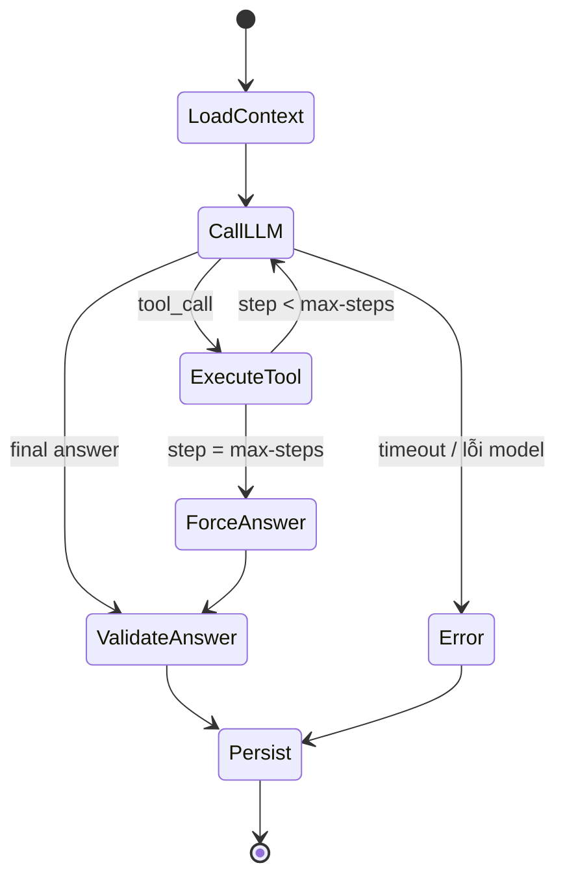

### 8.4. Guardrails
- **Phân quyền tool** theo vai trò người dùng của phiên (tool không được phép sẽ không có trong schema gửi LLM).
- **Tham số tool** được validate (Bean Validation) và giới hạn (`limit ≤ 50`, kỳ ≤ 12 tháng).
- **Chống prompt injection**: dữ liệu chứng từ được bọc `<erp_data>…</erp_data>`, system prompt nêu rõ không làm theo chỉ dẫn bên trong dữ liệu.
- **Masking** khi provider ≠ ollama: thay MST/số TK bằng token `[[TAX_1]]`, giữ bảng ánh xạ trong phiên để khôi phục khi hiển thị.
- **Ngân sách**: `max-steps = 6`, timeout LLM 60s, giới hạn token ngữ cảnh.

---

## 9. Thiết kế cơ sở dữ liệu

### 9.1. Hai nguồn dữ liệu

| Datasource | DBMS | Quyền | Công nghệ truy cập | Migration |
|---|---|---|---|---|
| `erp` | SQL Server (DB test công ty) | **Chỉ đọc** | `NamedParameterJdbcTemplate` + SQL file | Không |
| `app` (primary) | PostgreSQL 16 + pgvector | Đọc/ghi | Spring Data JPA; native SQL cho vector | Liquibase |

### 9.2. Canonical model ERP (record Java, không lưu)

```
ErpVoucher        { ref, companyId, voucherType, voucherNo, voucherDate, postedDate, description,
                    partner: ErpPartnerRef, currency, exchangeRate, totalAmount, lines: List<ErpJournalLine>,
                    invoice: ErpInvoice? , status, createdBy }
ErpJournalLine    { lineNo, description, debitAccount, creditAccount, amount, amountOriginal,
                    materialGoodsCode?, quantity?, unitPrice?, vatRate?, vatAmount?, vatAccount? }
ErpInvoice        { invoiceTemplate, invoiceSeries, invoiceNo, invoiceDate, sellerTaxCode, sellerName,
                    buyerTaxCode, amount, vatAmount, discountAmount, totalAmount, paymentMethod }
ErpAccount        { accountNumber, accountName, parentNumber, isDetail, accountingRegime }
ErpPartner        { code, name, taxCode, address, type }
```

Bảng ánh xạ cột thực tế của DB test → canonical model được ghi tại `docs/erp-mapping.md` (điền khi khảo sát DB test; ví dụ bảng `MaterialGoods`, khóa `CompanyID`).

### 9.3. Sơ đồ ERD (DB ứng dụng)

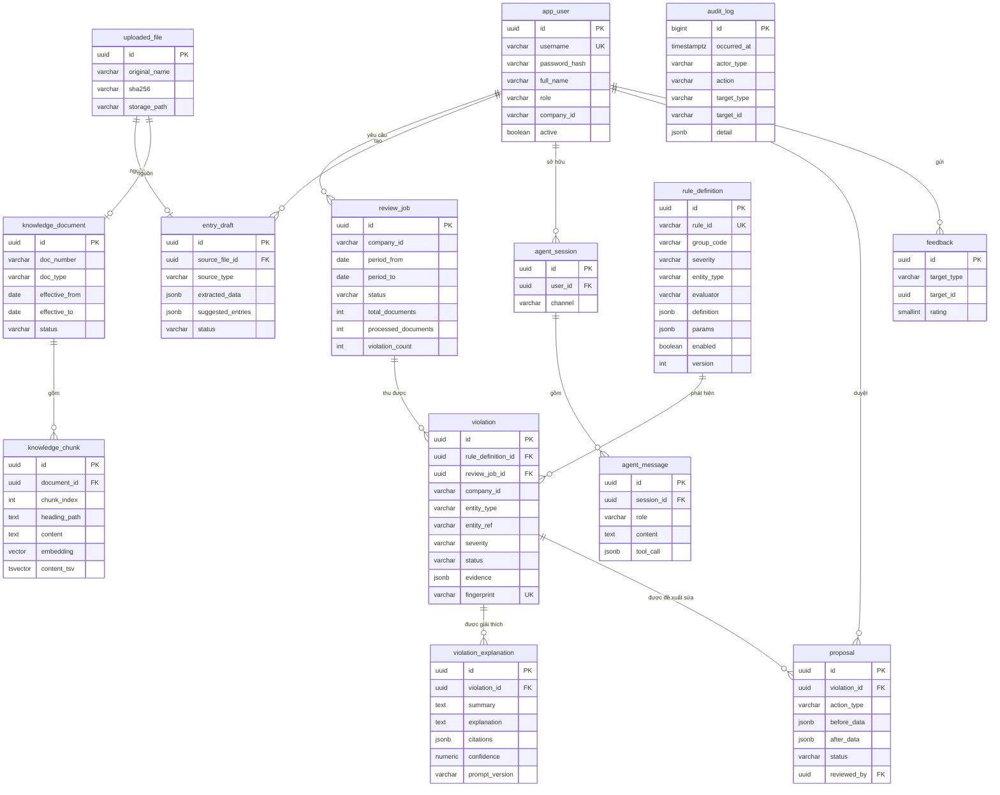

### 9.4. DDL chi tiết (PostgreSQL)

```sql
CREATE EXTENSION IF NOT EXISTS vector;
CREATE EXTENSION IF NOT EXISTS unaccent;
CREATE EXTENSION IF NOT EXISTS pgcrypto;

-- ============ AUTH ============
CREATE TABLE app_user (
    id              UUID PRIMARY KEY DEFAULT gen_random_uuid(),
    username        VARCHAR(50)  NOT NULL,
    password_hash   VARCHAR(100) NOT NULL,
    full_name       VARCHAR(150) NOT NULL,
    email           VARCHAR(150),
    role            VARCHAR(30)  NOT NULL CHECK (role IN ('ACCOUNTANT','CHIEF_ACCOUNTANT','ADMIN')),
    company_id      VARCHAR(64)  NOT NULL,              -- CompanyID bên ERP mà user được phép xem
    active          BOOLEAN      NOT NULL DEFAULT TRUE,
    created_at      TIMESTAMPTZ  NOT NULL DEFAULT now(),
    updated_at      TIMESTAMPTZ  NOT NULL DEFAULT now(),
    CONSTRAINT uk_app_user_username UNIQUE (username)
);

-- ============ FILE ============
CREATE TABLE uploaded_file (
    id              UUID PRIMARY KEY DEFAULT gen_random_uuid(),
    original_name   VARCHAR(255) NOT NULL,
    content_type    VARCHAR(100) NOT NULL,
    size_bytes      BIGINT       NOT NULL,
    sha256          CHAR(64)     NOT NULL,
    storage_path    VARCHAR(500) NOT NULL,
    purpose         VARCHAR(20)  NOT NULL CHECK (purpose IN ('ENTRY','KNOWLEDGE')),
    uploaded_by     UUID REFERENCES app_user(id),
    created_at      TIMESTAMPTZ  NOT NULL DEFAULT now()
);
CREATE INDEX idx_uploaded_file_sha256 ON uploaded_file (sha256);

-- ============ RULE ============
CREATE TABLE rule_definition (
    id              UUID PRIMARY KEY DEFAULT gen_random_uuid(),
    rule_id         VARCHAR(80)  NOT NULL,
    name            VARCHAR(255) NOT NULL,
    group_code      VARCHAR(10)  NOT NULL CHECK (group_code IN ('FLD','DOC','XDOC','REG','ANM')),
    severity        VARCHAR(10)  NOT NULL CHECK (severity IN ('ERROR','WARNING','INFO')),
    entity_type     VARCHAR(30)  NOT NULL,
    evaluator       VARCHAR(10)  NOT NULL CHECK (evaluator IN ('SPEL','SQL')),
    definition      JSONB        NOT NULL,             -- toàn bộ YAML đã parse
    params          JSONB        NOT NULL DEFAULT '{}',-- tham số có thể chỉnh qua Admin (ghi đè YAML)
    legal_refs      JSONB        NOT NULL DEFAULT '[]',
    rag_query       TEXT,
    enabled         BOOLEAN      NOT NULL DEFAULT TRUE,
    version         INT          NOT NULL DEFAULT 1,
    source_hash     CHAR(64)     NOT NULL,             -- hash file YAML, phát hiện thay đổi khi reload
    created_at      TIMESTAMPTZ  NOT NULL DEFAULT now(),
    updated_at      TIMESTAMPTZ  NOT NULL DEFAULT now(),
    CONSTRAINT uk_rule_definition_rule_id UNIQUE (rule_id)
);

CREATE TABLE review_job (
    id                  UUID PRIMARY KEY DEFAULT gen_random_uuid(),
    company_id          VARCHAR(64) NOT NULL,
    period_from         DATE        NOT NULL,
    period_to           DATE        NOT NULL,
    scope               JSONB       NOT NULL DEFAULT '{}',  -- entityTypes, ruleGroups, ruleIds
    status              VARCHAR(15) NOT NULL CHECK (status IN ('PENDING','RUNNING','COMPLETED','FAILED','CANCELLED')),
    total_documents     INT         NOT NULL DEFAULT 0,
    processed_documents INT         NOT NULL DEFAULT 0,
    total_batches       INT         NOT NULL DEFAULT 0,
    failed_batches      INT         NOT NULL DEFAULT 0,
    violation_count     INT         NOT NULL DEFAULT 0,
    requested_by        UUID        NOT NULL REFERENCES app_user(id),
    started_at          TIMESTAMPTZ,
    finished_at         TIMESTAMPTZ,
    error_message       TEXT,
    created_at          TIMESTAMPTZ NOT NULL DEFAULT now(),
    CONSTRAINT ck_review_job_period CHECK (period_from <= period_to)
);
CREATE INDEX idx_review_job_company_created ON review_job (company_id, created_at DESC);

CREATE TABLE violation (
    id                  UUID PRIMARY KEY DEFAULT gen_random_uuid(),
    rule_definition_id  UUID        NOT NULL REFERENCES rule_definition(id),
    rule_version        INT         NOT NULL,
    review_job_id       UUID        REFERENCES review_job(id) ON DELETE SET NULL,
    company_id          VARCHAR(64) NOT NULL,
    entity_type         VARCHAR(30) NOT NULL,
    entity_ref          VARCHAR(100) NOT NULL,          -- khóa chứng từ bên ERP
    entity_no           VARCHAR(50),                    -- số chứng từ hiển thị
    entity_date         DATE,
    severity            VARCHAR(10) NOT NULL,
    status              VARCHAR(25) NOT NULL CHECK (status IN
                        ('OPEN','EXPLAINED','PROPOSED','RESOLVED_PENDING_ERP','RESOLVED','DISMISSED')),
    message             TEXT        NOT NULL,
    evidence            JSONB       NOT NULL,
    fingerprint         CHAR(64)    NOT NULL,
    detected_at         TIMESTAMPTZ NOT NULL DEFAULT now(),
    last_seen_at        TIMESTAMPTZ NOT NULL DEFAULT now(),
    resolved_at         TIMESTAMPTZ,
    dismissed_by        UUID REFERENCES app_user(id),
    dismiss_reason      TEXT,
    CONSTRAINT uk_violation_fingerprint UNIQUE (fingerprint)
);
CREATE INDEX idx_violation_company_status   ON violation (company_id, status, severity);
CREATE INDEX idx_violation_entity           ON violation (entity_type, entity_ref);
CREATE INDEX idx_violation_review_job       ON violation (review_job_id);
CREATE INDEX idx_violation_entity_date      ON violation (company_id, entity_date);

-- ============ AGENT ============
CREATE TABLE violation_explanation (
    id              UUID PRIMARY KEY DEFAULT gen_random_uuid(),
    violation_id    UUID         NOT NULL REFERENCES violation(id) ON DELETE CASCADE,
    summary         TEXT         NOT NULL,
    explanation     TEXT         NOT NULL,
    citations       JSONB        NOT NULL DEFAULT '[]', -- [{chunkId, documentId, docNumber, headingPath, quote}]
    support_status  VARCHAR(15)  NOT NULL CHECK (support_status IN ('SUPPORTED','PARTIAL','UNSUPPORTED')),
    confidence      NUMERIC(4,3),
    model           VARCHAR(100) NOT NULL,
    prompt_version  VARCHAR(20)  NOT NULL,
    latency_ms      INT,
    created_at      TIMESTAMPTZ  NOT NULL DEFAULT now()
);
CREATE INDEX idx_violation_explanation_violation ON violation_explanation (violation_id, created_at DESC);

CREATE TABLE agent_session (
    id              UUID PRIMARY KEY DEFAULT gen_random_uuid(),
    user_id         UUID        NOT NULL REFERENCES app_user(id),
    company_id      VARCHAR(64) NOT NULL,
    channel         VARCHAR(10) NOT NULL CHECK (channel IN ('CHAT','ENTRY','REVIEW')),
    title           VARCHAR(255),
    created_at      TIMESTAMPTZ NOT NULL DEFAULT now(),
    last_activity_at TIMESTAMPTZ NOT NULL DEFAULT now()
);
CREATE INDEX idx_agent_session_user ON agent_session (user_id, last_activity_at DESC);

CREATE TABLE agent_message (
    id              UUID PRIMARY KEY DEFAULT gen_random_uuid(),
    session_id      UUID        NOT NULL REFERENCES agent_session(id) ON DELETE CASCADE,
    seq             INT         NOT NULL,
    role            VARCHAR(10) NOT NULL CHECK (role IN ('USER','ASSISTANT','TOOL','SYSTEM')),
    content         TEXT,
    tool_name       VARCHAR(60),
    tool_args       JSONB,
    tool_result     JSONB,
    citations       JSONB       NOT NULL DEFAULT '[]',
    tokens_in       INT,
    tokens_out      INT,
    latency_ms      INT,
    trace_id        VARCHAR(64),
    created_at      TIMESTAMPTZ NOT NULL DEFAULT now(),
    CONSTRAINT uk_agent_message_session_seq UNIQUE (session_id, seq)
);

-- ============ REVIEW / PROPOSAL ============
CREATE TABLE proposal (
    id              UUID PRIMARY KEY DEFAULT gen_random_uuid(),
    violation_id    UUID        REFERENCES violation(id) ON DELETE SET NULL,
    company_id      VARCHAR(64) NOT NULL,
    entity_type     VARCHAR(30) NOT NULL,
    entity_ref      VARCHAR(100) NOT NULL,
    action_type     VARCHAR(30) NOT NULL CHECK (action_type IN
                    ('UPDATE_FIELD','ADJUSTMENT_ENTRY','MARK_DUPLICATE','CANCEL_VOUCHER')),
    before_data     JSONB       NOT NULL,
    after_data      JSONB       NOT NULL,
    changes         JSONB       NOT NULL,              -- [{path, from, to}]
    rationale       TEXT        NOT NULL,
    citations       JSONB       NOT NULL DEFAULT '[]',
    verification    JSONB       NOT NULL,              -- kết quả chạy lại rule trên after_data
    status          VARCHAR(15) NOT NULL CHECK (status IN
                    ('PENDING','APPROVED','REJECTED','SUPERSEDED','EXPORTED')),
    created_by_type VARCHAR(10) NOT NULL CHECK (created_by_type IN ('AGENT','USER')),
    created_by      UUID REFERENCES app_user(id),
    reviewed_by     UUID REFERENCES app_user(id),
    reviewed_at     TIMESTAMPTZ,
    review_note     TEXT,
    exported_at     TIMESTAMPTZ,
    created_at      TIMESTAMPTZ NOT NULL DEFAULT now(),
    CONSTRAINT ck_proposal_reject_note CHECK (status <> 'REJECTED' OR review_note IS NOT NULL)
);
CREATE INDEX idx_proposal_company_status ON proposal (company_id, status, created_at DESC);
CREATE INDEX idx_proposal_violation      ON proposal (violation_id);

-- ============ ENTRY ============
CREATE TABLE entry_draft (
    id                UUID PRIMARY KEY DEFAULT gen_random_uuid(),
    company_id        VARCHAR(64) NOT NULL,
    source_type       VARCHAR(10) NOT NULL CHECK (source_type IN ('XML','IMAGE','PDF','TEXT')),
    source_file_id    UUID REFERENCES uploaded_file(id),
    source_text       TEXT,
    voucher_type      VARCHAR(30),
    extracted_data    JSONB       NOT NULL,            -- dữ liệu chứng từ đã trích xuất / người dùng sửa
    field_confidence  JSONB       NOT NULL DEFAULT '{}',
    suggested_entries JSONB       NOT NULL DEFAULT '[]', -- [{debitAccount, creditAccount, amount, reason}]
    validation        JSONB       NOT NULL DEFAULT '[]', -- kết quả rule gần nhất
    status            VARCHAR(12) NOT NULL CHECK (status IN ('DRAFT','VALIDATED','CONFIRMED','DISCARDED')),
    created_by        UUID        NOT NULL REFERENCES app_user(id),
    created_at        TIMESTAMPTZ NOT NULL DEFAULT now(),
    updated_at        TIMESTAMPTZ NOT NULL DEFAULT now()
);
CREATE INDEX idx_entry_draft_user ON entry_draft (created_by, created_at DESC);

-- ============ KNOWLEDGE ============
CREATE TABLE knowledge_document (
    id              UUID PRIMARY KEY DEFAULT gen_random_uuid(),
    title           VARCHAR(500) NOT NULL,
    doc_number      VARCHAR(100),
    doc_type        VARCHAR(15)  NOT NULL CHECK (doc_type IN ('LAW','DECREE','CIRCULAR','MANUAL','INTERNAL')),
    issued_date     DATE,
    effective_from  DATE,
    effective_to    DATE,
    superseded_by   UUID REFERENCES knowledge_document(id),
    source_url      VARCHAR(1000),
    file_id         UUID REFERENCES uploaded_file(id),
    status          VARCHAR(10)  NOT NULL CHECK (status IN ('PENDING','INGESTING','READY','FAILED','ARCHIVED')),
    chunk_count     INT          NOT NULL DEFAULT 0,
    embedding_model VARCHAR(100),
    error_message   TEXT,
    created_at      TIMESTAMPTZ  NOT NULL DEFAULT now(),
    updated_at      TIMESTAMPTZ  NOT NULL DEFAULT now()
);
CREATE INDEX idx_knowledge_document_effective ON knowledge_document (status, effective_from, effective_to);

CREATE TABLE knowledge_chunk (
    id              UUID PRIMARY KEY DEFAULT gen_random_uuid(),
    document_id     UUID         NOT NULL REFERENCES knowledge_document(id) ON DELETE CASCADE,
    chunk_index     INT          NOT NULL,
    heading_path    TEXT         NOT NULL,             -- "Chương II > Điều 5 > Khoản 2"
    article_no      VARCHAR(20),
    clause_no       VARCHAR(20),
    content         TEXT         NOT NULL,
    token_count     INT          NOT NULL,
    embedding       vector(1024) NOT NULL,
    content_tsv     tsvector GENERATED ALWAYS AS (to_tsvector('simple', unaccent(heading_path || ' ' || content))) STORED,
    created_at      TIMESTAMPTZ  NOT NULL DEFAULT now(),
    CONSTRAINT uk_knowledge_chunk_doc_idx UNIQUE (document_id, chunk_index)
);
CREATE INDEX idx_knowledge_chunk_embedding ON knowledge_chunk USING hnsw (embedding vector_cosine_ops);
CREATE INDEX idx_knowledge_chunk_tsv       ON knowledge_chunk USING gin (content_tsv);
CREATE INDEX idx_knowledge_chunk_document  ON knowledge_chunk (document_id);

-- ============ AUDIT ============
CREATE TABLE audit_log (
    id              BIGSERIAL PRIMARY KEY,
    occurred_at     TIMESTAMPTZ NOT NULL DEFAULT now(),
    actor_type      VARCHAR(10) NOT NULL CHECK (actor_type IN ('USER','AGENT','SYSTEM')),
    actor_id        VARCHAR(64),
    company_id      VARCHAR(64),
    action          VARCHAR(60) NOT NULL,              -- PROPOSAL_APPROVED, RULE_UPDATED, TOOL_CALLED...
    target_type     VARCHAR(40),
    target_id       VARCHAR(100),
    detail          JSONB       NOT NULL DEFAULT '{}',
    trace_id        VARCHAR(64),
    ip_address      VARCHAR(45)
);
CREATE INDEX idx_audit_log_target ON audit_log (target_type, target_id);
CREATE INDEX idx_audit_log_time   ON audit_log (company_id, occurred_at DESC);
-- audit_log chỉ INSERT: thu hồi quyền UPDATE/DELETE của user ứng dụng
-- REVOKE UPDATE, DELETE ON audit_log FROM erpai;

CREATE TABLE feedback (
    id              UUID PRIMARY KEY DEFAULT gen_random_uuid(),
    target_type     VARCHAR(20) NOT NULL CHECK (target_type IN ('EXPLANATION','ANSWER','PROPOSAL','ENTRY_SUGGESTION')),
    target_id       UUID        NOT NULL,
    user_id         UUID        NOT NULL REFERENCES app_user(id),
    rating          SMALLINT    NOT NULL CHECK (rating IN (-1, 1)),
    comment         TEXT,
    created_at      TIMESTAMPTZ NOT NULL DEFAULT now(),
    CONSTRAINT uk_feedback_target_user UNIQUE (target_type, target_id, user_id)
);
```

### 9.5. Vòng đời trạng thái violation

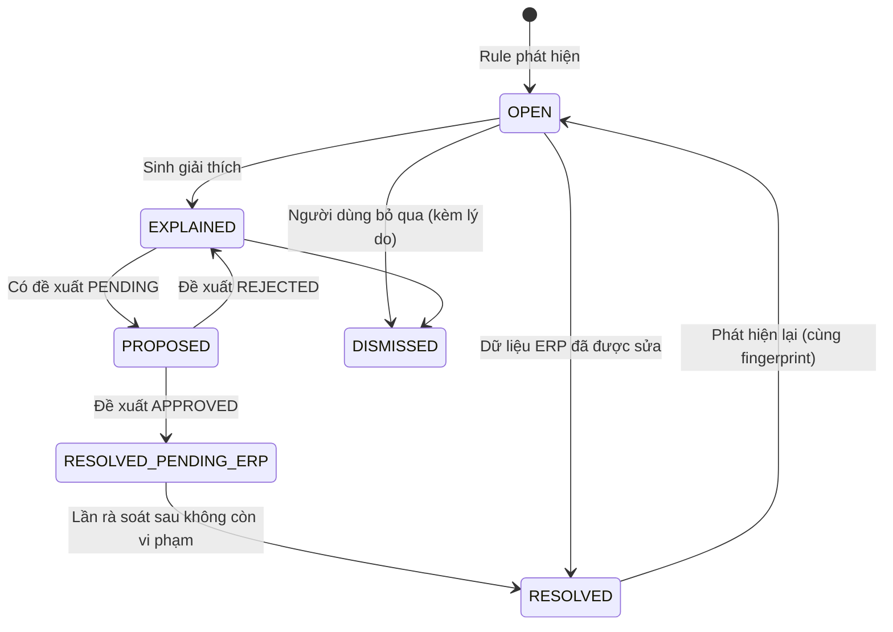

---

## 10. Bảo mật

| Khía cạnh | Biện pháp |
|---|---|
| Xác thực | JWT (access 60 phút) + refresh token; mật khẩu BCrypt |
| Phân quyền | RBAC 3 vai trò; lọc dữ liệu theo `company_id` của user ở mọi query ERP và DB app |
| Dữ liệu ERP | Tài khoản SQL Server chỉ `db_datareader`; transaction `readOnly`; review code chặn câu lệnh ghi |
| LLM | Mặc định local; provider cloud bắt buộc `PiiMaskingService`; không log prompt đầy đủ ở INFO |
| Prompt injection | Bọc dữ liệu không tin cậy, tool whitelist theo quyền, validate tham số tool, giới hạn bước |
| Upload | Giới hạn 10 MB, kiểm tra MIME thực (Tika), XML parser tắt DTD/External Entity (chống XXE) |
| Audit | `audit_log` append-only, có `trace_id` liên kết với log & trace LLM |
| Secrets | `.env` / biến môi trường, không commit; `.env.example` không chứa giá trị thật |

---

## 11. Yêu cầu phi chức năng & triển khai

### 11.1. Mục tiêu NFR

| Chỉ số | Mục tiêu (môi trường demo, CPU 8 core / 16–32 GB RAM) |
|---|---|
| Rà soát tức thời 1 chứng từ | P95 < 1 s |
| Rà soát hàng loạt | ≥ 1.000 chứng từ / phút (không gồm sinh giải thích) |
| Giải thích 1 lỗi | P95 < 15 s (Ollama 7B CPU); < 5 s với GPU/cloud |
| Truy xuất RAG (hybrid + rerank) | P95 < 800 ms |
| Độ chính xác rule | Precision ≥ 0.95, Recall ≥ 0.90 trên bộ dữ liệu cài lỗi |
| RAG | Hit@5 ≥ 0.8 trên bộ câu hỏi đánh giá |

### 11.2. Sơ đồ triển khai

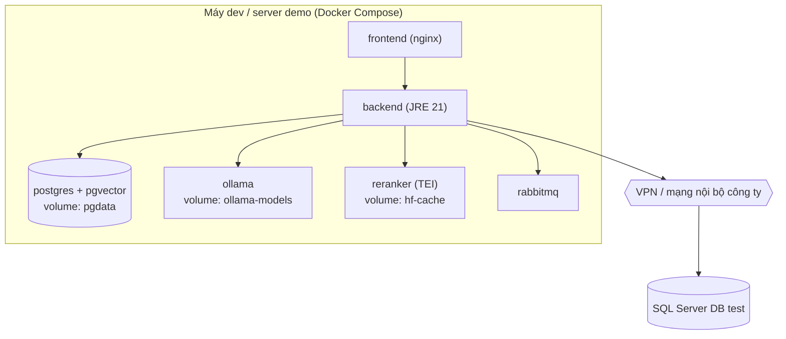

### 11.3. Observability
- **Log**: JSON (logstash encoder), có `traceId`, `userId`, `companyId`.
- **Metrics** (Micrometer, `/actuator/prometheus`): `rule.evaluation.duration`, `rag.retrieval.duration`, `llm.call.duration`, `llm.tokens`, `review.job.documents`.
- **Trace LLM**: Langfuse (tùy chọn) — mỗi workflow là một trace, mỗi lời gọi LLM/tool là một span.

---

## 12. Quyết định kiến trúc (ADR)

| ADR | Quyết định | Lý do chính | Phương án đã cân nhắc |
|---|---|---|---|
| 0001 | Modular monolith | Đơn giản vận hành, phù hợp quy mô đồ án, vẫn giữ ranh giới module | Microservices |
| 0002 | Toàn bộ backend Java + Spring AI | Nhóm thành thạo Spring; một stack, một lần deploy | Spring Boot + Python (LangGraph/FastAPI) |
| 0003 | DB ERP chỉ đọc, đề xuất qua phê duyệt | Dữ liệu gần thật; an toàn; đúng nguyên tắc human-in-the-loop | Agent ghi trực tiếp ERP |
| 0004 | Rule YAML + SpEL/SQL | Nhẹ, dễ đọc, thêm rule không cần build lại | Drools |
| 0005 | PostgreSQL + pgvector làm vector store | Một DB cho cả nghiệp vụ và vector, hỗ trợ hybrid search bằng SQL | Qdrant, Elasticsearch |
| 0006 | LLM local (Ollama) mặc định | Bảo mật dữ liệu, không tốn phí API | Chỉ dùng Cloud API |
| 0007 | Workflow tường minh thay vì agent tự trị | Hành vi dự đoán được, test được, giải trình được | Agent ReAct tự do cho mọi tác vụ |
| 0008 | Chat dùng vòng lặp công cụ tường minh (JSON `{tool,args}`) thay vì `@Tool` của Spring AI | Kiểm soát số bước, phân quyền công cụ trước khi vào prompt, dễ test bằng LLM giả | `@Tool` + vòng lặp nội bộ của Spring AI |
| 0009 | Trích xuất hóa đơn bằng LLM chỉ chạy với LLM local | Ảnh hóa đơn không che PII được; che MST/tên sẽ phá chính dữ liệu cần trích | Gửi ảnh lên LLM cloud sau khi che |
| 0010 | Rule SQL chạy qua danh sách tham số cho phép + tên file `rule-*.sql` | Rule liên chứng từ vẫn thuần đọc, chống SQL injection và đọc file tùy ý | Cho rule tự viết SQL tự do |
| 0011 | Khóa hóa đơn bán hàng dạng `GUID@yyyy-MM-dd` | PK `SAInvoice(Date, ID)` đánh index/phân vùng theo ngày; tra theo ID đơn lẻ sẽ quét bảng 12 triệu dòng | Chỉ dùng GUID |

Chi tiết từng ADR: `docs/adr/NNNN-*.md`.

---

## 13. Đối chiếu thiết kế ↔ triển khai

Phần này ghi các điểm triển khai **khác hoặc vượt** so với thiết kế ở các mục trên. Mục nào không nhắc ở đây là đúng như thiết kế.

### 13.1. Module và phụ thuộc
- `common.llm` (`LlmClient`, `SpringAiLlmClient`), `common.pii`, `common.storage`, `common.export` (XLSX/PDF) là gói trung lập; `agent` và `entry` cùng dùng `LlmClient` mà không phụ thuộc lẫn nhau.
- Ranh giới module được ArchUnit kiểm tra (`ModuleDependencyTest`): không dùng chéo `repository`/`domain` của module khác; hễ vi phạm thì chuyển kiểu dùng chung (enum, DTO) ra gói `service` công khai.
- `rule.review` chứa job rà soát hàng loạt (RabbitMQ: exchange `review.exchange`, queue `review.batch`, DLQ `review.batch.dlq`, retry 3 lần).

### 13.2. Rule engine (§6)
- Hai evaluator: `SpelRuleEvaluator` (hàm thuần, ngữ cảnh khóa: không `T(...)`, không constructor, method chỉ trên BigDecimal/String/Collection/Map) và `SqlRuleEvaluator` (có hàng trả về = vi phạm; `forEach: lines` chạy theo từng dòng).
- Rule khai báo thêm `entityTypes` (nhiều loại chứng từ) và `needs: [ACCOUNTS]` (dữ liệu tham chiếu nạp một lần/lần đánh giá, cache 10 phút).
- Rule đang có: `FLD_REQUIRED_FIELDS`, `FLD_TAX_CODE_FORMAT`, `DOC_ACCOUNT_NOT_DETAIL`, `DOC_VAT_AMOUNT_MISMATCH` (tắt: chờ xác nhận đơn vị `VATRate`), `XDOC_DUPLICATE_INVOICE`, `REG_ACCOUNT_REGIME_MISMATCH`, `REG_CASH_PAYMENT_THRESHOLD` (tắt: chờ xác nhận ngưỡng pháp lý), `ANM_UNIT_PRICE_OUTLIER`. Chưa có `DOC_DEBIT_CREDIT_UNBALANCED`, `DOC_TOTAL_MISMATCH`, `DOC_INVALID_VAT_RATE`, `FLD_DATE_OUT_OF_PERIOD`, `XDOC_PAYMENT_EXCEEDS_DEBT`, `XDOC_NEGATIVE_STOCK`.
- Cấu hình admin (bật/tắt, mức độ, tham số) giữ nguyên khi YAML đổi; `POST /rules/{id}/test` chạy thử không lưu.

### 13.3. RAG (§7)
- `content_tsv` dùng hàm `immutable_unaccent` (migration 010) vì `unaccent()` không IMMUTABLE.
- LLM trích dẫn theo **số thứ tự đoạn** (`index`) thay vì `chunkId` (mô hình nhỏ hay sai chuỗi hex); backend ánh xạ sang `chunkId` và kiểm tra `quote` là chuỗi con của đoạn.
- Định dạng nạp: pdf (có lớp chữ), docx (đọc `word/document.xml`, chặn XXE/zip bomb), txt, md. Tài liệu có `PATCH` (ngày hiệu lực đổi có tác dụng ngay) và `DELETE` (lưu trữ + xóa chunk).

### 13.4. Agent (§8)
- Công cụ (`agent.tool`): `query_erp_vouchers`, `get_erp_voucher`, `run_rules`, `get_violation`, `list_violations`, `search_knowledge`, `create_proposal` (chỉ CHIEF/ADMIN). Mô tả tham số do LLM sinh ra luôn bị validate lại.
- Chat: mỗi bước LLM trả `{tool,args}` hoặc `final`; dừng khi lặp lại cùng một lời gọi hoặc hết `app.agent.max-steps`; câu trả lời cuối được stream; nếu truy xuất tài liệu mà không đủ căn cứ thì từ chối, không gọi LLM.
- Với `AI_PROVIDER` ≠ ollama, prompt được che (MST, số tài khoản, tên đối tác) và câu trả lời được khôi phục — nên không stream từng token trong chế độ này.
- Giải thích lỗi trả JSON (mặc định) hoặc SSE (`stage` → `result`); đề xuất sửa do LLM gợi ý chỉ lưu khi qua kiểm chứng rule.

### 13.5. Nhập liệu (§5.1) — module `entry`
- Nguồn: XML Thông tư 78 (tất định, độ tin cậy 1.0), PDF/ảnh/văn bản (LLM local, độ tin cậy tối đa 0.95).
- Độ tin cậy LLM = điểm của mô hình hạ xuống nếu tổng dòng ≠ tiền hàng, tiền hàng + thuế ≠ thanh toán, hoặc MST sai định dạng/chữ số kiểm tra. Trường dưới `app.entry.min-confidence` được trả trong `lowConfidenceFields`.
- Gợi ý định khoản: mặc định tất định (156/1331 – 331); với LLM local + danh mục tài khoản, LLM chọn tài khoản Nợ **chỉ trong danh mục công ty**.
- Nháp chạy qua cùng rule engine như chứng từ ERP; `confirm` chốt dữ liệu để xuất (JSON/XLSX), không ghi ERP.

### 13.6. Loại chứng từ ERP (§9.2)
- Có adapter: hóa đơn mua hàng (`PPInvoice`), hóa đơn bán hàng (`SAInvoice`) và 6 loại chứng từ dùng chung `ErpVoucherKindAdapter` (phiếu chi `MCPayment`, phiếu thu `MCReceipt`, báo Nợ `MBTellerPaper`, báo Có `MBDeposit`, hàng mua trả lại `PPDiscountReturn`, hàng bán trả lại `SAReturn`; cùng bộ alias cột SQL, được test đối chiếu). Mọi luồng dùng `ErpQueryService.getVoucher/listVouchers/countVouchers/listVoucherIds(type, …)`. Chi tiết ánh xạ và điểm cần xác nhận với dữ liệu thật: `docs/erp-mapping.md`.

### 13.7. Phê duyệt và xuất (§5.5)
- Proposal chỉ có `UPDATE_FIELD` (đường dẫn như `lines[0].vatAmount`, `partner.taxCode`); kiểm chứng = áp lên bản sao rồi chạy lại **mọi** rule, từ chối nếu vi phạm gốc còn hoặc xuất hiện lỗi ERROR mới.
- Xuất phiếu đề nghị: CSV, XLSX, PDF (nhúng DejaVu Sans). `ErpWriteBackPort` mặc định `ExportOnlyWriteBack`.

### 13.8. Đã bổ sung sau đó
- `GET /erp/vouchers` chuyển sang `web.VoucherSearchController` (tầng tổng hợp, vì `erp` không được phụ thuộc `rule`): lọc `q`, `partnerTaxCode`, `hasViolations`; trả `openViolationCount`, `maxSeverity`.
- Rule mới: `FLD_DATE_IN_FUTURE` (bật); `DOC_TOTAL_MISMATCH`, `DOC_INVALID_VAT_RATE`, `XDOC_PAYMENT_EXCEEDS_DEBT` (TẮT cho đến khi xác nhận với dữ liệu thật). Không làm `XDOC_NEGATIVE_STOCK` (chưa có adapter kho) và kiểm tra kỳ khóa sổ (schema chỉ có cột `ID` ở `LockAccount`).
- Metrics Micrometer qua `AppMetrics`: `rule.evaluation` (nhãn `rule`), `llm.call`, `rag.retrieval` (nhãn `outcome`). Chưa thêm `micrometer-registry-prometheus` nên `/actuator/prometheus` chưa có dữ liệu xuất.
- Đánh giá offline (`vn.edu.uet.erpai.eval`, profile `eval`): sinh chứng từ tổng hợp cài lỗi có nhãn, precision/recall từng rule SpEL, thông lượng 1000 chứng từ, `RankingMetrics` (Hit@k, MRR) cho RAG; báo cáo Markdown vào `eval/reports/`.

- Bảo mật prompt: `PromptSafety` vô hiệu hóa `<` `>` trong dữ liệu không tin cậy (ADR 0012).
- Đánh giá RAG: `RagEvalRunner` đọc `eval/datasets/rag-questions.json` (mẫu: `rag-questions.example.json`; câu hỏi và đoạn luật đúng do người dùng cung cấp), tính Hit@1/3/5, MRR, tỷ lệ từ chối đúng với câu hỏi ngoài kho, p50/p95.
- `GET /erp/vouchers?hasViolations=true`: `q` lọc ở phía vi phạm (đúng tổng số/phân trang), kết hợp với `partnerTaxCode` trả 422; mỗi chứng từ được tải riêng từ ERP nên nên tải theo lô khi số lượng lớn.
- Kiểm tra giả định dữ liệu ERP: `docs/erp-verification.md`.

### 13.9. Chưa làm
Chạy với SQL Server/Ollama/reranker thật (chưa có môi trường), runner RAG trên mô hình thật và đo tỷ lệ đề xuất qua kiểm chứng, rule `XDOC_NEGATIVE_STOCK`, Langfuse/OTel, giảm giá bán hàng (TypeID 340–345 chưa xác định bảng).
